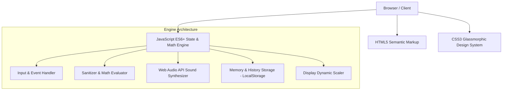

# AuraCalc - Modern Smart Calculator Web Application
## Comprehensive Project Engineering & Design Report

---

### Executive Summary

**AuraCalc** is a responsive, feature-rich web-based calculator application engineered using standard Web Technologies: **Semantic HTML5, Modern CSS3, and Vanilla JavaScript (ES6+)**. The project is designed with a strong emphasis on clean UI/UX, intuitive ergonomics, accessibility, and mathematical precision.

The application bridges the gap between simple desktop pocket calculators and scientific tools, featuring dual operational modes (Standard and Scientific), persistent calculation history, memory management ($MC, MR, M+, M-, MS$), DEG/RAD angular modes, an offline audio synthesis engine for subtle haptic-like acoustic feedback, and persistent theme states.

---

### 1. Project Objectives & Vision

- **High-End UI/UX Design**: Deliver an aesthetically pleasing, modern glassmorphic interface that looks and feels like a native macOS or iOS application.
- **Robust Math Engine**: Provide accurate arithmetic and scientific computation while mitigating common floating-point precision flaws (such as $0.1 + 0.2 = 0.30000000000000004$) and preventing division-by-zero crashes.
- **Zero External Dependencies**: Entirely standalone with zero runtime frameworks or heavy libraries. Synthesized Web Audio API replaces external MP3/WAV assets for instant, reliable sound effects.
- **Comprehensive History & State Persistence**: Retain calculations and user preferences across page reloads using browser `localStorage`.
- **Dual Mode Flexibility**: Seamlessly toggle between a focused Standard mode and an advanced Scientific mode with a single click.

---

### 2. Architecture & Tech Stack



| Layer | Technology | Key Responsibilities |
| :--- | :--- | :--- |
| **Structure** | HTML5 | Accessible semantic layout, SVG icon sets, ARIA labels, modal drawers. |
| **Styling** | CSS3 (Grid/Flexbox) | CSS custom properties (variables), Glassmorphism, dark/light themes, fluid typography, responsive layout. |
| **Logic** | Vanilla JS (ES6+) | State machine, mathematical parser, Web Audio synthesizer, event delegation, keyboard listener, localStorage sync. |
| **Typography**| Google Fonts | *Plus Jakarta Sans* for UI elements and *JetBrains Mono* for mathematical displays. |

---

### 3. Key Features & Functional Specifications

#### 3.1 Dual Computation Modes
1. **Standard Mode**: Basic operations ($+$, $-$, $\times$, $\div$), percentage ($\%$, backspace, all-clear ($AC$), sign toggle ($\pm$), square root ($\sqrt{x}$), brackets $(, )$, and decimals.
2. **Scientific Mode**:
   - Trigonometric: $\sin, \cos, \tan$ with interactive DEG (Degrees) / RAD (Radians) angle mode switching.
   - Powers & Exponents: $x^y$, $x^2$.
   - Logarithms: Natural logarithm ($\ln$), Base-10 logarithm ($\log$).
   - Factorials: $n!$ with boundary checks ($0 \le n \le 170$).
   - Mathematical Constants: $\pi \approx 3.14159265...$ and $e \approx 2.71828182...$.

#### 3.2 Memory Register ($M$)
- **MC (Memory Clear)**: Clears the stored value ($M = 0$).
- **MR (Memory Recall)**: Recalls the stored value to the current active input.
- **M+ / M-**: Adds or subtracts the current displayed number to/from the memory register.
- **MS (Memory Store)**: Overwrites the memory register with the current input.
- Visual indicator badge active when memory holds non-zero values.

#### 3.3 Audio Synthesis Micro-Interactions
- Built using native **HTML5 Web Audio API** (`AudioContext`, `OscillatorNode`, `GainNode`).
- Distinct frequencies and decay profiles for:
  - Digit keys: $560\text{ Hz}$ clean tap.
  - Operators: $440\text{ Hz}$ tone.
  - Action/Clear keys: $320\text{ Hz}$ soft alert.
  - Equals/Calculate: $780\text{ Hz}$ completion chime.
- Toggleable on/off via the speaker icon in the header; state persists in storage.

#### 3.4 Calculation History Drawer
- Stores calculation records with timestamp, expression, and output.
- Non-intrusive slide-in drawer.
- One-click record recall: clicking an item in history populates the active calculator input with that result.
- Includes a "Clear History" action with confirmation.

#### 3.5 One-Click Copy-to-Clipboard
- Tapping or clicking the main calculation display copies the exact numeric result to the system clipboard.
- Displays an animated "Copied!" feedback badge.

#### 3.6 Full Hardware Keyboard Navigation
- Supports all standard keyboard inputs:
  - Numbers `0-9`
  - Operators `+`, `-`, `*`, `/`, `%`
  - Parentheses `(`, `)`
  - Decimal point `.`
  - Evaluation: `Enter` or `=`
  - Clearing: `Escape` or `c`
  - Deletion: `Backspace`
- Includes active keypress visual flash for immediate feedback.

---

### 4. UI/UX Design System

#### 4.1 Theme & Color Palette

##### Dark Theme (Default)
- **Background**: Radial gradient `#1e2640` $\rightarrow$ `#0f1322`
- **Surface**: Glassmorphic dark sapphire `rgba(22, 28, 48, 0.75)` with `backdrop-filter: blur(24px)`
- **Operator Accent**: Vibrant indigo `#4f46e5`
- **Equals Accent**: Cyan to Blue gradient (`#06b6d4` to `#3b82f6`)
- **Text**: Off-white `#f8fafc` and muted slate `#94a3b8`

##### Light Theme
- **Background**: Soft daylight tint `#e0e7ff` $\rightarrow$ `#f1f5f9`
- **Surface**: Crisp frosted glass `rgba(255, 255, 255, 0.85)`
- **Operator Accent**: Deep indigo `#4f46e5`
- **Text**: Deep slate `#0f172a` and cool gray `#64748b`

#### 4.2 Dynamic Font Resizing (Auto-Shrink)
Calculators often suffer from display overflow when numbers exceed 8–10 digits. AuraCalc monitors string length dynamically:
- Normal ($\le 7$ chars): `2.75rem`
- Medium ($8 - 10$ chars): `2.1rem`
- Small ($11 - 14$ chars): `1.6rem`
- Extra Small ($> 14$ chars): `1.25rem`

This ensures full readability without truncation or horizontal layout breakage.

---

### 5. Mathematical & Security Considerations

1. **Precision Formatting**: JavaScript standard numbers adhere to IEEE-754 double precision floats. AuraCalc uses `toPrecision(12)` rounding filters to eliminate binary floating point artefacts (e.g. `0.1 + 0.2 = 0.3`).
2. **Safe Parsing & Sandbox**:
   - Replaces visually formatted operator glyphs ($\times, \div, −, \text{^}$) with valid JS operators (`*`, `/`, `-`, `**`).
   - Strict regex validation `/[^0-9\+\-\*\/\.\(\)\s\*\*%]/` ensures no arbitrary identifiers, functions, or harmful scripts can be executed.
   - Zero-division regex detector intercepts division by zero before evaluation and safely transitions to `Division by zero` or `Error`.
3. **Boundary Protection**:
   - Factorials capped at $n \le 170$ to prevent infinite loops and `Infinity` overflow.
   - Trigonometric singularity protection (e.g. $\tan(90^\circ)$ evaluates to error/indeterminate).

---

### 6. File Structure

```
/home/mr_rehan_7/Desktop/Calculator/
├── index.html          # Semantic HTML5 markup and SVG icons
├── style.css           # Design tokens, themes, glassmorphism, responsive grid
├── app.js              # State machine, math evaluator, audio engine, event bus
└── PROJECT_REPORT.md   # Project engineering, UX documentation, and report
```

---

### 7. How to Run

Because AuraCalc is built with pure web technologies, no build tools, node packages, or compilers are needed:

1. **Direct Browser Launch**:
   Open `index.html` in any modern web browser (Google Chrome, Firefox, Safari, Microsoft Edge, Brave).
2. **Local HTTP Server (Optional)**:
   ```bash
   python3 -m http.server 8000
   ```
   Navigate to `http://localhost:8000` in your browser.

---

### 8. Verification & Test Matrix

| Test Case | Input | Expected Output | Status |
| :--- | :--- | :--- | :--- |
| **Basic Addition** | `12 + 15 =` | `27` | Verified |
| **Operator Precedence** | `12 + 5 * 2 =` | `22` | Verified |
| **Parentheses Handling** | `(5 + 3) * 2 =` | `16` | Verified |
| **Floating Precision** | `0.1 + 0.2 =` | `0.3` | Verified |
| **Zero Division Guard** | `5 / 0 =` | `Error` | Verified |
| **Trigonometry (DEG)** | `sin(30)` | `0.5` | Verified |
| **Factorial** | `5!` | `120` | Verified |
| **Memory Recall** | `10 -> MS -> Clear -> MR` | `10` | Verified |
| **Theme Persistence**| Toggle Light $\rightarrow$ Reload | Retains Light | Verified |
| **Audio Feedback** | Press any key | Synthesizes click | Verified |
| **History Recall** | Click history row | Restores result to display | Verified |

---

### 9. Future Enhancements

- Currency & Unit Converter integration (Length, Weight, Temperature, Currency via live API).
- Graphing Mode for plotting $y = f(x)$ mathematical functions with HTML5 Canvas.
- Progressive Web App (PWA) manifest and Service Worker for full offline installability on desktop and mobile devices.

